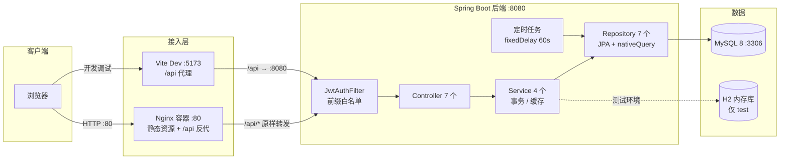
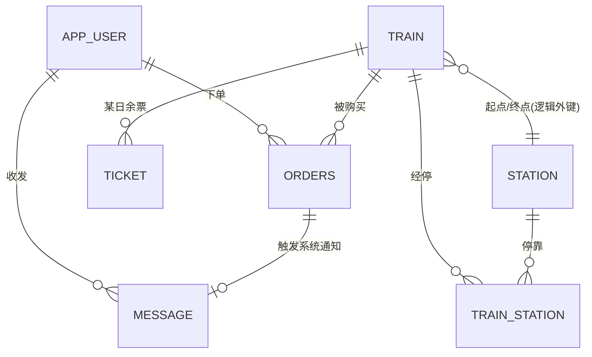

# Implementation Plan: 铁路购票系统（Railway Ticket）

**Branch**: `001-railway-ticket`
**Date**: 2026-11-14
**Spec**: `./spec.md`
**Constitution**: `../../.specify/memory/constitution.md`
**Tasks**: `./tasks.md`
**Source**: 由原 `docs/SDD.md`（软件设计文档 v1.0）的详细设计章节整合而来，该旧文件已删除；WHAT/WHY 见 `spec.md`

> 本文档只回答 **HOW**。每条决策可追溯到 `spec.md` 的 FR/NFR 编号；未完成项在 `tasks.md` 登记。

## Summary

前后端分离的铁路购票系统：Spring Boot 后端暴露 23 个 `/api` 端点，Vue 3 前端通过同源 `/api` 访问，MySQL 持久化。并发安全由数据库条件更新保证，重复查询由 Caffeine 短缓存承担。交付采用 Docker Compose 三服务（含健康检查）+ GitHub Actions CI，测试使用 H2 内存库以便无外部依赖运行。

## Technical Context

| 层 | 选型 | 版本 | 理由 / 约束 |
| --- | --- | --- | --- |
| 后端 | Java / Spring Boot / Spring MVC / Data JPA | 17 / 4.1.1 | 项目基线，不可随意升级 |
| 缓存 | Spring Cache + Caffeine | BOM 管理 | 余票查询高频，30s 短缓存 |
| 安全 | JJWT + BCrypt + 自研过滤器 | 0.12.6 | 轻量演示；未引入 Spring Security（见 T101/T103） |
| 文档/监控 | springdoc-openapi、Actuator + Micrometer Prometheus | 2.8.8 | dev Swagger、健康检查与指标 |
| 前端 | Vue / Vue Router / Pinia / Element Plus / Axios / Vite | 3.5 / 5.4 / 4.1 / 8 | 组件按需自动导入、代码分块 |
| 数据 | MySQL（dev/prod）、H2 内存库（test） | 8.0 | 测试不依赖本机 MySQL |
| 部署 | Docker Compose + Nginx；Render Blueprint | — | 容器/裸机两套 Nginx 配置 |
| 测试 | JUnit 5 + Mockito + AssertJ + `@SpringBootTest` | — | 20 个测试，`mvn verify` 全绿 |

## Constitution Check

| 原则 | 满足 | 说明 |
| --- | --- | --- |
| I. 数据库是并发真相 | ✅ | 8 条条件更新 SQL + `@Transactional`；⚠️ 座位号无唯一约束、无迁移脚本（T102/T105） |
| II. 契约稳定 | ✅ | 统一 `Result<T>`、23 端点与文档一致；新增端点需同步 spec/plan |
| III. 环境隔离与最小权限 | ⚠️ 部分 | prod 演示数据已关闭、密钥已外置、CORS 已可按白名单收紧；但白名单外免鉴权、密钥仍有默认值（T103/T104） |
| IV. 可验证交付 | ✅ | 18 测试 + CI 3 job + Compose 实测 + 404 冒烟 |
| V. 文档与代码同源 | ✅ | 本次规格化把数字与代码反向核对；全部修复文件已暂存（T112 完成） |

## Architecture



## Project Structure

```
src/main/java/com/example/demo/
  controller/   7 个 @RestController，23 端点
  service/      UserService / TicketService / OrderService / MessageService
  repository/   7 个 JpaRepository，8 条原子 UPDATE
  entity/ dto/  7 实体 + 2 枚举 + 8 DTO/VO
  security/     JwtAuthFilter / JwtUtil
  config/       WebConfig(CORS + PasswordEncoder) / DataInitializer
  task/         OrderAutoCompleteTask
  common/       Result / BusinessException / GlobalExceptionHandler
src/main/resources/       application{,-dev,-prod}.properties
src/test/                 20 个测试 + application-test.properties
frontend/src/             views(8) / components(5) / router / stores / utils
docker/                   Dockerfile.backend / Dockerfile.frontend / nginx.conf
deploy/                   nginx/railway.conf（裸机）、scripts/*
.github/workflows/        ci.yml
specs/001-railway-ticket/ spec.md / plan.md / tasks.md
.specify/                 memory/constitution.md、templates/*
```

## Key Design Decisions

### ADR-001: 用数据库条件更新防止超卖

- **关联需求**: FR-020、FR-024、NFR-001
- **决策**: `TicketRepository` 用 8 条 `nativeQuery = true` 的 `UPDATE`：扣减带 `AND <col> > 0` 并返回受影响行数，`OrderService` 以 `affected == 0` 判定余票不足；回补为无条件 `+1`。
- **理由**: 数据库行锁保证并发下不出现负库存，避免应用层「先查后改」的竞态。
- **备选与否决原因**: 应用层 `synchronized`/乐观锁版本号——跨实例失效或改动面过大；`SELECT ... FOR UPDATE`——增加一次往返且与 JPA 派生查询割裂。
- **证据**: `src/main/java/com/example/demo/repository/TicketRepository.java:23-69`、`OrderService.java:57-60`，单测 `OrderServiceTest.buyTicketShouldFailWhenNoSeatLeft`。

### ADR-002: 前缀白名单式 JWT 鉴权

- **关联需求**: FR-005、FR-006、NFR-011
- **决策**: `JwtAuthFilter` 维护 `PUBLIC_PREFIXES` 与 `AUTH_REQUIRED_PREFIXES`，`startsWith` 匹配；命中后者才校验 Bearer 并注入 `request.setAttribute("userId", ...)`。
- **理由**: 演示系统无需完整安全框架，改动小、易于理解。
- **备选与否决原因**: Spring Security 默认全局拦截 + 显式放行——引入成本高、会改变现有响应格式（401 JSON 由过滤器直接写出）。
- **已知后果**: 两张表之外的路径（`/api/train/**`、`/api/dashboard/**`）**免鉴权**；用户相关项是完整路径而非 `/api/user/` 前缀，新增端点默认放行。已登记为 **T103**。
- **证据**: `security/JwtAuthFilter.java:18-35,45-72`。

### ADR-003: 多阶段 Docker 构建 + 环境变量绑定

- **关联需求**: NFR-005、FR-048
- **决策**: `Dockerfile.backend` 在 `maven:3.9-eclipse-temurin-17` 阶段执行 `mvn -DskipTests clean package`，运行阶段只复制 jar；`ENTRYPOINT ["sh","-c","exec java $JAVA_OPTS -jar app.jar"]`，数据源/JWT/profile 全部由 Spring Boot 从环境变量绑定。
- **理由**: Render 与 CI 的构建上下文没有 `target/*.jar`；exec 形式数组不会展开 `${...}`，原先手写的 `-Dspring.datasource.url=${DB_HOST:-mysql}...` 会把字面量传给 JVM 导致 prod 连不上库。
- **备选与否决原因**: 保留单阶段并预先本地打包——无法在 Render/CI 复现；改 `ENTRYPOINT ["java", ...]` 静态参数——无法覆盖不同环境。
- **证据**: `docker/Dockerfile.backend`、实测 `Image demo2-backend Built` + backend `healthy`。
- **遗留**: 依赖缓存分层已于 2026-11-15 实施（T058：`pom.xml` → `dependency:go-offline` 独立层 → `COPY src/`），`docker build --check` 无告警；仅改源码时的重建提速数据待补（T109）。

### ADR-004: 两套 Nginx 配置 + `$request_uri`

- **关联需求**: FR-048、NFR-005、NFR-006
- **决策**: 容器用 `docker/nginx.conf`（root `/usr/share/nginx/html`，反代 `backend:8080`）；裸机用 `deploy/nginx/railway.conf`（root `/var/www/railway-frontend`，反代 `127.0.0.1:8080`）。容器配置使用 `resolver 127.0.0.11` + 变量形式 `proxy_pass http://$backend_service:8080$request_uri;`。
- **理由**: 变量形式 `proxy_pass` 在请求期解析 Docker DNS，避免后端未就绪时 Nginx 启动失败；**带固定 URI 的变量形式会把整个请求路径替换成该 URI**，实测曾导致 `/api/station/list` 变成 `/api/`，后端抛 `NoResourceFoundException` 并被误报成 500。`$request_uri` 保留完整路径与查询串。
- **备选与否决原因**: 静态 `proxy_pass http://backend:8080`（启动期解析，后端重启换 IP 后会指向旧地址）；`sed` 替换裸机配置（脆弱）。
- **证据**: `docker/nginx.conf:16-35`，实测 `/api/station/list` → `code:200`。

### ADR-005: 演示数据双开关

- **关联需求**: FR-044、NFR-002
- **决策**: `app.data-init.enabled`（`@ConditionalOnProperty`，控制是否创建 `DataInitializer` Bean）与 `app.demo-data.enabled`（`@Value`，控制弱口令账号与 50 条模拟订单）。dev 全开；prod 保留基础数据但关闭演示数据；test 全部关闭。
- **理由**: 站点/车次/余票是系统可用性的前提，prod 也需要；测试账号与假订单则是安全隐患。
- **备选与否决原因**: 整个初始化器加 `@Profile("dev")`——prod 数据库会完全没有车次，演示不可用；仅靠 README 提醒——代码无隔离，实测发现 prod 仍会灌入。
- **证据**: `config/DataInitializer.java`，prod 日志 `用户数: 0`、`历史订单: 0`，测试 `Demo2ApplicationTests.dataInitializerShouldBeDisabledInTestProfile`。

### ADR-006: H2 内存库 + 条件化初始化

- **关联需求**: NFR-004
- **决策**: `@ActiveProfiles("test")` + `src/test/resources/application-test.properties`（H2 `MODE=MySQL`、`ddl-auto=create-drop`、`spring.cache.type=none`、`app.data-init.enabled=false`）；方言由 Hibernate 自动识别，主配置不再写死 `MySQLDialect`。
- **理由**: `contextLoads()` 原本是空方法且会尝试连本机 MySQL；改为真实断言后必须让测试自包含。
- **备选与否决原因**: CI 起一个 MySQL 服务容器——增加流水线复杂度与耗时；Mock 掉全部 Repository——失去集成价值。
- **证据**: `.\mvnw.cmd -B test` → 20 tests / 0 failures（无本机 MySQL 依赖）。

### ADR-007: 统一响应与 404 异常分类

- **关联需求**: FR-040、FR-041、NFR-006
- **决策**: `Result<T>{code,message,data}`；`BusinessException` 默认 400，参数校验 400，兜底 500，均返回 HTTP 200 + `body.code`；`NoResourceFoundException` 单独用 `ResponseEntity` 返回 **HTTP 404 + code 404**。
- **理由**: 前端 `request.js` 按 `body.code` 判定；把「路径不存在」报成 500 会掩盖问题并误导排查（实测暴露）。
- **备选与否决原因**: 全部改成标准 HTTP 状态码——破坏前端拦截器与既有 23 个端点的契约。
- **证据**: `common/GlobalExceptionHandler.java`，实测未知路径 HTTP 404 `{"code":404,...}`，单测 `GlobalExceptionHandlerTest` 2 个。

### ADR-008: 短缓存与写后失效

- **关联需求**: FR-013、NFR-008
- **决策**: `TicketService.queryTickets` 使用 `@Cacheable("tickets", key=起站_到站_日期)`；`buyTicket`/`refundTicket` 使用 `@CacheEvict(cacheNames="tickets", allEntries=true)`。Caffeine `expireAfterWrite=30s, maximumSize=500`。
- **理由**: 余票查询远多于写操作，30s 容忍度可接受；写后立即失效避免脏读。
- **遗留**: `cache-names` 声明了 `stations`/`trains` 但代码未使用（**T106**）。
- **证据**: `TicketService.java:32`、`OrderService.java:43,167`、`application.properties`。

### ADR-009: 宿主机 3306 → 3307

- **关联需求**: FR-048
- **决策**: Compose 映射 `3307:3306`；容器内仍是 3306，后端通过服务名 `mysql:3306` 访问。
- **理由**: 实测本机 `MySQL80` 服务占用 3306，容器启动报 `ports are not available`。
- **备选与否决原因**: 停止系统 MySQL 服务——影响用户其它工作，侵入性高。
- **证据**: `docker-compose.yml`，`docker compose ps` 显示 `0.0.0.0:3307->3306/tcp`。

### ADR-010: 采用 Spec Kit 三件套作为事实来源

- **关联需求**: NFR-010、宪法 V
- **决策**: `.specify/memory/constitution.md` + `.specify/templates/*` + `specs/001-railway-ticket/{spec,plan,tasks}.md`；原 `docs/SDD.md` 内容拆分整合后删除。
- **理由**: 单份设计文档无法表达「需求 / 方案 / 进度」三种不同生命周期的信息；Spec Kit 目录让后续特性可复用模板。
- **备选与否决原因**: 保留单一 `SDD.md` 并追加章节——需求与实现混杂、无法标记任务状态。
- **证据**: 本文件、`spec.md`、`tasks.md` 及一致性校验结果。

### ADR-011: 分域名部署的两处配置化

- **关联需求**: FR-048、NFR-012、spec 待澄清问题 3
- **决策**: 前端用构建期 `VITE_API_BASE_URL`（Docker 镜像为 `--build-arg`）指向后端绝对地址；后端用运行时 `APP_CORS_ALLOWED_ORIGINS` → `app.cors.allowed-origins` 配置 `allowedOriginPatterns`，多个来源逗号分隔、支持通配符，空值回退 `*`。
- **理由**: 具体域名属于部署环境信息，不应写进代码或仓库；同源反代部署保持默认 `*`，行为不变。
- **备选与否决原因**: 在 `WebConfig` 写死白名单——换域名就要改代码并重建镜像；继续全开 `*`——公网分域名部署不安全。
- **证据**: `config/WebConfig.java`、`application.properties`、`.env.example`、`docker-compose.yml`、`README.md` 分域名部署小节，`WebConfigTest` 2 个测试。
- **遗留**: 真实域名仍需部署方提供；`allowCredentials(true)` 与具体来源搭配需部署后用 OPTIONS 预检验证。

## Data Model

### 实体关系



> 实体间仅用 `Long` 保存 ID，**无 JPA 关联映射、无数据库外键**，一致性由应用层保证。

### 表清单

| 表 | 主要字段 | 约束 |
| --- | --- | --- |
| `app_user` | id、username、password(BCrypt)、realName、idCard、phone、seatType、create_time、update_time | username unique/not null；`@PrePersist`/`@PreUpdate` |
| `station` | id、name、city、code | name not null；`idx_station_name` |
| `train` | id、trainNumber、trainType、from_station_id、to_station_id、startTime、endTime、duration、四类价格 | trainNumber unique/not null |
| `train_station` | id、train_id、station_id、sort、arriveTime、departTime | 三者 not null |
| `ticket` | id、train_id、trainDate、四类 `*_count` | **`UNIQUE(train_id, train_date)`**；计数默认 0 |
| `orders` | id、orderNo、user_id、train_id、trainNumber、from/to_station、trainDate、seatType、seatNo、passenger_*、price、status、create_time、pay_time | orderNo unique；时间由 Service 赋值 |
| `message` | id、sender_id、receiver_id、content(TEXT)、type、is_read、related_order_id、create_time | type 默认 SYSTEM；is_read 默认 false |

**枚举**：`OrderStatus` = `PENDING/PAID/REFUNDED/CANCELLED/COMPLETED`（实际写入 PAID、REFUNDED、COMPLETED；`from()` 对非法值返回 null）；`SeatType` = 商务座 / 一等座 / 二等座 / 硬卧，各携带 label、Java 字段、DB 列名、价格字段。

**原子更新**：4 × `deduct*Seat`（`SET col=col-1 ... AND col > 0`）、4 × `restore*Seat`（`SET col=col+1`），共 8 条 `@Modifying(nativeQuery=true)`。

**迁移现状**：`ddl-auto=update`，无 `.sql`、无 Flyway/Liquibase → **T102**。

## API Contracts

Base path `/api`；统一 `Result<T>`；需登录接口带 `Authorization: Bearer <token>`，Controller 用 `@RequestAttribute("userId")`。下表「入参」不含该隐式参数。

**[P]** 公开白名单 / **[A]** 强制鉴权 / **[-]** 两表之外（免鉴权）

| 模块 | 方法 | 路径 | 入参 | 返回 | 鉴权 |
| --- | --- | --- | --- | --- | --- |
| 用户 | POST | `/api/user/register` | `RegisterRequest` | `Result<User>` | [P] |
| 用户 | POST | `/api/user/login` | `LoginRequest` | `Result<LoginResponse>` | [P] |
| 用户 | GET | `/api/user/info` | — | `Result<User>` | [A] |
| 用户 | POST | `/api/user/change-password` | `{oldPassword,newPassword}` | `Result<Void>` | [A] |
| 用户 | PUT | `/api/user/profile` | `{realName,idCard,phone}` | `Result<User>` | [A] |
| 票务 | GET | `/api/ticket/query` | `fromStation,toStation,date` | `Result<List<TrainTicketVO>>` | [P] |
| 站点 | GET | `/api/station/list` | — | `Result<List<Station>>` | [P] |
| 站点 | GET | `/api/station/search` | `keyword?` | `Result<List<Station>>` | [P] |
| 车次 | GET | `/api/train/{trainId}/stops` | `trainId` | 经停站列表 | [-] |
| 订单 | POST | `/api/order/buy` | `BuyTicketRequest` | `Result<Order>` | [A] |
| 订单 | GET | `/api/order/my` | — | `Result<List<Order>>` | [A] |
| 订单 | POST | `/api/order/refund/{orderId}` | `orderId` | `Result<Order>` | [A] |
| 消息 | GET | `/api/message/search-users` | `kw` | `Result<List<UserVO>>` | [A] |
| 消息 | POST | `/api/message/send` | `SendMessageRequest` | `Result<Message>` | [A] |
| 消息 | GET | `/api/message/conversations` | — | 会话列表 | [A] |
| 消息 | GET | `/api/message/history` | `userId2` | `Result<List<Message>>` | [A] |
| 消息 | POST | `/api/message/read` | `conversationUserId` | `Result<Integer>` | [A] |
| 消息 | GET | `/api/message/unread-count` | — | `Result<Long>` | [A] |
| 消息 | GET | `/api/message/system` | — | `Result<List<Message>>` | [A] |
| 消息 | POST | `/api/message/mark-all-read` | — | `Result<Integer>` | [A] |
| 看板 | GET | `/api/dashboard/overview` | — | 统计概览 | [-] |
| 看板 | GET | `/api/dashboard/top-routes` | — | Top10 | [-] |
| 看板 | GET | `/api/dashboard/trend` | — | 近 7 日趋势 | [-] |

## Configuration

| 配置 / 变量 | dev | prod | test |
| --- | --- | --- | --- |
| 数据源 | `localhost:3306/railway_ticket` | `SPRING_DATASOURCE_*` 必填 | H2 `jdbc:h2:mem:railway_test;MODE=MySQL` |
| `ddl-auto` | `update` | `update` | `create-drop` |
| SQL 日志 | 开启 + trace | 关闭，root warn | 关闭 |
| Swagger | 开启 | 关闭 | 关闭 |
| 缓存 | Caffeine | Caffeine | `none` |
| `app.data-init.enabled` | `true` | `true` | `false` |
| `app.demo-data.enabled` | `true` | `false` | `false` |
| JWT | `JWT_SECRET` / `JWT_EXPIRATION=86400000`（有内置默认值） | 同左 | 测试固定密钥 |
| `APP_CORS_ALLOWED_ORIGINS` → `app.cors.allowed-origins` | `*` | `*` 或部署方白名单 | `*` |
| `VITE_API_BASE_URL`（构建期） | `/api`（Vite 代理） | `/api` 同源 / 绝对地址分域名 | — |

公共项：`server.port=8080`、`GMT+8`、Jackson `yyyy-MM-dd'T'HH:mm:ssXXX`、`spring.jpa.open-in-view=false`、方言自动识别、Actuator 暴露 `health,info,metrics,prometheus,caches`。

**分域名部署**：前端构建期指定 `VITE_API_BASE_URL=https://后端域名/api`，后端运行时通过 `.env` 的 `APP_CORS_ALLOWED_ORIGINS=https://前端域名` 收紧白名单；同源反代部署两项均保持默认，详见 ADR-011 与 `README.md`。

## Deployment & Verification

| 服务 | 宿主机端口 | 容器端口 | 依赖 | 健康检查 |
| --- | --- | --- | --- | --- |
| `railway-mysql` | `3307` | `3306` | — | `mysqladmin ping` 5s/20 次 |
| `railway-backend` | `8080` | `8080` | mysql `service_healthy` | `/actuator/health` 10s/12 次 |
| `railway-frontend` | `80` | `80` | backend `service_healthy` | — |

- 构建：两个多阶段 Dockerfile；`.dockerignore` 排除 `node_modules`/`target`/`.git`/日志/`.env`。
- 密钥：根目录 `.env`（模板 `.env.example`，不入库）：`DB_ROOT_PWD`、`DB_USER_PWD`、`JWT_SECRET`。
- Render：`dockerfilePath: ./docker/Dockerfile.backend`，前端静态站点需另部署并配置 `VITE_API_BASE_URL`。
- 裸机：`deploy/scripts/build-all.bat|sh` 打包，`app.sh` 管理进程并校验数据源变量。
- 冒烟清单：首页与入口 JS、直连/反代健康检查、`/api/station/list`、带查询串的搜索、看板概览、**未知路径必须 404**。

## Testing Strategy

| 层级 | 手段 | 覆盖 |
| --- | --- | --- |
| 单元 | JUnit 5 + Mockito + AssertJ（真实 BCrypt / JJWT） | Service 分支、JWT、异常分类、CORS 白名单解析 |
| 集成 | `@SpringBootTest` + H2 + `@ActiveProfiles("test")` | 上下文装配、Bean 条件开关 |
| 构建 | `npm ci && npm run build`、`docker compose config --quiet` | 前端产物、Compose 语法 |
| 运行时 | 容器 healthcheck + HTTP 冒烟 | 见下 |

**20 个测试**：`Demo2ApplicationTests`(2)、`GlobalExceptionHandlerTest`(2)、`JwtUtilTest`(3)、`OrderServiceTest`(4)、`UserServiceTest`(7)、`WebConfigTest`(2)。

**CI**（`.github/workflows/ci.yml`）：`push(main/master)` 与 `pull_request` 触发 3 个 job — `backend`（Temurin 17 + `sh ./mvnw -B verify`）、`frontend`（Node 22 + `npm ci` + `npm run build`）、`compose`（`docker compose config --quiet`）。

## Verification Results（2026-11-13 ~ 14）

| 项 | 结果 |
| --- | --- |
| `.\mvnw.cmd -B test` | 20 tests / 0 failures / `BUILD SUCCESS` |
| CORS 白名单配置化 | `WebConfigTest` 2 个测试通过；默认 `*` 不改变同源部署 |
| `npm run build` | 成功 |
| `docker compose up -d --build` | 三容器启动，mysql/backend `healthy` |
| 首页、入口 JS、健康检查（直连与反代） | HTTP 200 |
| `/api/station/list`、`/api/station/search?keyword=...`、`/api/dashboard/overview` | `code:200` |
| 未知路径（直连与经 Nginx） | HTTP 404 `{"code":404,"message":"请求的资源不存在"}` |
| 前端产物 | 无旧外部域名，走同源 `/api` |
| `docker build --check -f docker/Dockerfile.backend .` | `Check complete, no warnings found`（依赖分层后） |
| `docker compose ps`（新增 frontend healthcheck） | mysql / backend / frontend 均 healthy；首页与 `/api/station/list` 经 Nginx 仍 200 |
| prod 数据隔离 | `用户数: 0`、`历史订单: 0`、车次 179、余票 1253 |

## Known Limitations

| 任务 ID | 限制 | 违反的宪法原则 |
| --- | --- | --- |
| T101 | CORS 全开 + `allowCredentials(true)`；无 Spring Security / refresh token / 登出黑名单 | III |
| T102 | `ddl-auto=update`，无迁移脚本与回滚 | I |
| T103 | 白名单鉴权「两表之外直接放行」 | III |
| T104 | 密钥与数据库口令仍有内置默认值 | III |
| T105 | 座位号分配无数据库唯一约束 | I |
| T106 | `stations`/`trains` 缓存名未使用；定时任务吞掉单条异常 | I / IV |
| T107 | 无 LICENSE | V |
| T108 | 无前端 E2E、ESLint/Prettier | IV |
| T109 | 依赖分层已实施，重建提速尚缺一次真实构建的实测数据 | IV |
| T110 | `Confetti.vue` 孤立；AI 助手密钥存 `localStorage` 且默认模拟模式 | III |
| T111 | 无日志归档 / 链路追踪 | IV |
| T113 | `spec.md` 第 9 章剩余 4 个 `[NEEDS CLARIFICATION]` 待决策（原第 3 项已由 T057 / ADR-011 解决） | V |
