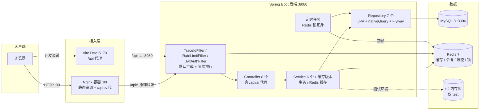
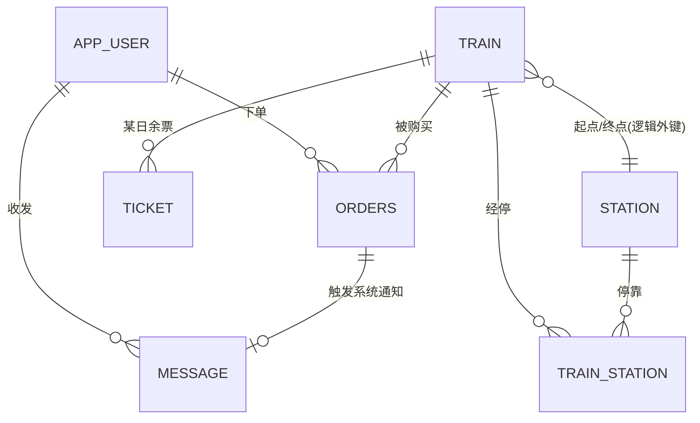

# Implementation Plan: 铁路购票系统（Railway Ticket）

**Branch**: `001-railway-ticket`
**Date**: 2026-11-14
**Spec**: `./spec.md`
**Constitution**: `../../.specify/memory/constitution.md`
**Tasks**: `./tasks.md`
**Source**: 由原 `docs/SDD.md`（软件设计文档 v1.0）的详细设计章节整合而来，该旧文件已删除；WHAT/WHY 见 `spec.md`

> 本文档只回答 **HOW**。每条决策可追溯到 `spec.md` 的 FR/NFR 编号；未完成项在 `tasks.md` 登记。

## Summary

前后端分离的铁路购票系统：Spring Boot 后端暴露 27 个 `/api` 端点，Vue 3 前端通过同源 `/api` 访问，MySQL 持久化（prod 由 Flyway 管理 schema）。并发安全由数据库条件更新与座位唯一约束保证，重复查询由 Caffeine（dev）/ Redis（prod）短缓存承担，登录态（refresh token / 登出黑名单）、接口限流与定时任务互斥同样基于 Redis。交付采用 Docker Compose 四服务（MySQL + Redis + 后端 + 前端，含健康检查）与可选 Zipkin profile，配套 GitHub Actions CI；测试使用 H2 内存库，Redis 全链路测试用 Testcontainers（无 Docker 时跳过），前端用 Vitest + Playwright。

## Technical Context

| 层 | 选型 | 版本 | 理由 / 约束 |
| --- | --- | --- | --- |
| 后端 | Java / Spring Boot / Spring MVC / Data JPA | 17 / 4.1.1 | 项目基线，不可随意升级 |
| 缓存 | Spring Cache + Caffeine / Redis（Spring Data Redis + Lettuce） | BOM 管理 | dev 本地 Caffeine；prod 共享 Redis，余票 30s、站点/车次 600s |
| 安全 | JJWT + BCrypt + 自研过滤器（默认拦截 + 黑名单/限流/refresh token） | 0.12.6 | 轻量演示；未引入完整 Spring Security（T101 已按自研方案闭环） |
| 文档/监控 | springdoc-openapi、Actuator + Micrometer Prometheus、Micrometer Tracing + Brave | 2.8.8 | dev Swagger、健康检查、缓存命中率、traceId 与可选 Zipkin |
| 前端 | Vue / Vue Router / Pinia / Element Plus / Axios / Vite | 3.5 / 5.4 / 4.1 / 8 | 组件按需自动导入、代码分块；Vitest + Playwright + ESLint + Prettier |
| 数据 | MySQL（dev/prod）、H2 内存库（test）、Flyway（prod 迁移） | 8.0 | 测试不依赖本机 MySQL；prod schema 由 Flyway 管理 |
| 部署 | Docker Compose + Nginx；Render Blueprint | — | 容器/裸机两套 Nginx 配置；Redis 与可选 Zipkin |
| 测试 | JUnit 5 + Mockito + AssertJ + `@SpringBootTest` + Testcontainers | — | 49 个测试（6 个需 Docker，无 Docker 时跳过），`mvn verify` 全绿 |

## Constitution Check

| 原则 | 满足 | 说明 |
| --- | --- | --- |
| I. 数据库是并发真相 | ✅ | 8 条条件更新 SQL + `@Transactional`；座位唯一约束（T105）+ Flyway V1/V2 迁移（T102） |
| II. 契约稳定 | ✅ | 统一 `Result<T>`、27 端点与文档一致；新增端点需同步 spec/plan |
| III. 环境隔离与最小权限 | ✅ | prod 演示数据关闭、密钥外置且启动强校验；`/api` 默认拦截 + 显式放行、黑名单/refresh/限流（T101/T103/T104） |
| IV. 可验证交付 | ✅ | 49 后端测试 + 11 Vitest + 2 E2E + CI 3 job + Compose 实测 + 404 冒烟 |
| V. 文档与代码同源 | ✅ | 规格、方案、任务三件套与 README 数字反向核对；2026-11-17 重新核验 |

## Architecture



## Project Structure

```
src/main/java/com/example/demo/
  controller/   8 个 @RestController，27 端点
  service/      6 个业务 Service + TicketCacheVersion
  repository/   7 个 JpaRepository，8 条原子 UPDATE
  entity/ dto/  7 实体 + 2 枚举 + DTO/VO
  security/     JwtAuthFilter / JwtUtil / TokenService / RateLimitFilter
  config/       WebConfig / DataInitializer / RedisConfig / ProdSecurityValidator
                / TraceIdFilter / TracingConfig / AiProperties
  task/         OrderAutoCompleteTask / RedisTaskLock
  common/       Result / BusinessException / GlobalExceptionHandler
src/main/resources/       application{,-dev,-prod}.properties、logback-spring.xml、db/migration/V1~V2
src/test/                 49 个测试（6 个 Testcontainers）+ application-test.properties
frontend/src/             views(8) / components(4) / router / stores / utils / test
frontend/tests/e2e/       Playwright 端到端测试
docker/                   Dockerfile.backend{,.maven} / Dockerfile.frontend / nginx.conf
deploy/                   nginx/railway.conf（裸机）、scripts/*
.github/workflows/        ci.yml
specs/001-railway-ticket/ spec.md / plan.md / tasks.md
.specify/                 memory/constitution.md、templates/*
```

## Key Design Decisions

### ADR-001: 用数据库条件更新防止超卖

- **关联需求**: FR-020、FR-024、NFR-001
- **决策**: `TicketRepository` 用 8 条 `nativeQuery = true` 的 `UPDATE`：扣减带 `AND <col> > 0` 并返回受影响行数，`OrderService` 以 `affected == 0` 判定余票不足；回补为无条件 `+1`。
- **理由**: 数据库行锁保证并发下不出现负库存，避免应用层「先查后改」的竞态。
- **备选与否决原因**: 应用层 `synchronized`/乐观锁版本号——跨实例失效或改动面过大；`SELECT ... FOR UPDATE`——增加一次往返且与 JPA 派生查询割裂。
- **证据**: `src/main/java/com/example/demo/repository/TicketRepository.java:23-69`、`OrderService.java:57-60`，单测 `OrderServiceTest.buyTicketShouldFailWhenNoSeatLeft`。

### ADR-002: 默认拦截 + 显式放行的 JWT 鉴权

- **关联需求**: FR-005、FR-006、NFR-011
- **决策**: `JwtAuthFilter` 只维护 `PUBLIC_API_PREFIXES`（login/register/refresh 与查询类接口）；其余 `/api/**` 默认要求 Bearer token，校验通过后注入 `request.setAttribute("userId", ...)`，黑名单命中返回 401。Redis 模式下另由 `RateLimitFilter` 按 IP 限流，`TokenService` 负责 refresh 轮换与登出撤销。
- **理由**: 修正原先「白名单外直接放行」的缺陷，使新增端点默认受保护；演示系统无需完整安全框架，保持轻量与既有 401 JSON 响应格式。
- **备选与否决原因**: Spring Security 默认全局拦截 + 显式放行——引入成本高且会改变现有响应格式；继续前缀两张表——新增端点易漏配（T103 已修复）。
- **已知后果**: 非 `/api` 路径（Actuator、Swagger、静态资源、`/error`）不走此过滤器，由部署层控制访问。
- **证据**: `security/JwtAuthFilter.java:21-80`、`security/TokenService.java`、`security/RateLimitFilter.java`、`JwtAuthFilterTest` 5 例、`TokenServiceTest`、`RateLimitFilterTest`。

### ADR-003: 多阶段 Docker 构建 + 环境变量绑定

- **关联需求**: NFR-005、FR-048
- **决策**: 默认 `Dockerfile.backend` 直接复制宿主机 `mvnw package` 生成的 jar（本机 Docker Desktop 代理会导致镜像内 Maven 下载出现 `bad_record_mac`）；镜像内打包方式保留为 `Dockerfile.backend.maven`（Render 使用）。`ENTRYPOINT ["sh","-c","exec java $JAVA_OPTS -jar app.jar"]`，数据源/JWT/profile 全部由 Spring Boot 从环境变量绑定。
- **理由**: Render 与 CI 的构建上下文没有 `target/*.jar`；exec 形式数组不会展开 `${...}`，原先手写的 `-Dspring.datasource.url=${DB_HOST:-mysql}...` 会把字面量传给 JVM 导致 prod 连不上库。
- **备选与否决原因**: 保留单阶段并预先本地打包——无法在 Render/CI 复现；改 `ENTRYPOINT ["java", ...]` 静态参数——无法覆盖不同环境。
- **证据**: `docker/Dockerfile.backend`、`docker/Dockerfile.backend.maven`、实测 `Image demo2-backend Built` + backend `healthy`。
- **遗留**: 无。默认 Dockerfile 改为复制本地 jar 后不再有依赖分层；`Dockerfile.backend.maven` 仍保留 T058 的依赖分层（`pom.xml` → `dependency:go-offline` → `COPY src/`），T109 的构建耗时数据基于该镜像内打包方案。

### ADR-004: 两套 Nginx 配置 + `$request_uri`

- **关联需求**: FR-048、NFR-005、NFR-006
- **决策**: 容器用 `docker/nginx.conf`（root `/usr/share/nginx/html`，反代 `backend:8080`）；裸机用 `deploy/nginx/railway.conf`（root `/var/www/railway-frontend`，反代 `127.0.0.1:8080`）。容器配置使用 `resolver 127.0.0.11` + 变量形式 `proxy_pass http://$backend_service:8080$request_uri;`。
- **理由**: 变量形式 `proxy_pass` 在请求期解析 Docker DNS，避免后端未就绪时 Nginx 启动失败；**带固定 URI 的变量形式会把整个请求路径替换成该 URI**，实测曾导致 `/api/station/list` 变成 `/api/`，后端抛 `NoResourceFoundException` 并被误报成 500。`$request_uri` 保留完整路径与查询串。
- **备选与否决原因**: 静态 `proxy_pass http://backend:8080`（启动期解析，后端重启换 IP 后会指向旧地址）；`sed` 替换裸机配置（脆弱）。
- **证据**: `docker/nginx.conf:16-35`，实测 `/api/station/list` → `code:200`。

### ADR-005: 演示数据双开关

- **关联需求**: FR-044、NFR-002
- **决策**: `app.data-init.enabled`（`@ConditionalOnProperty`，控制是否创建 `DataInitializer` Bean）与 `app.demo-data.enabled`（`@Value`，控制弱口令账号与 50 条模拟订单）。dev 全开；prod 保留基础数据但关闭演示数据；test 全部关闭。
- **理由**: 站点/车次/余票是系统可用性的前提，prod 也需要；测试账号与假订单则是安全隐患。
- **备选与否决原因**: 整个初始化器加 `@Profile("dev")`——prod 数据库会完全没有车次，演示不可用；仅靠 README 提醒——代码无隔离，实测发现 prod 仍会灌入。
- **证据**: `config/DataInitializer.java`，prod 日志 `用户数: 0`、`历史订单: 0`，测试 `Demo2ApplicationTests.dataInitializerShouldBeDisabledInTestProfile`。

### ADR-006: H2 内存库 + 条件化初始化

- **关联需求**: NFR-004
- **决策**: `@ActiveProfiles("test")` + `src/test/resources/application-test.properties`（H2 `MODE=MySQL`、`ddl-auto=create-drop`、`spring.cache.type=none`、`app.data-init.enabled=false`）；方言由 Hibernate 自动识别，主配置不再写死 `MySQLDialect`。
- **理由**: `contextLoads()` 原本是空方法且会尝试连本机 MySQL；改为真实断言后必须让测试自包含。
- **备选与否决原因**: CI 起一个 MySQL 服务容器——增加流水线复杂度与耗时；Mock 掉全部 Repository——失去集成价值。
- **证据**: `.\mvnw.cmd -B verify` → 49 tests / 0 failures / 6 skipped（无本机 MySQL 依赖；Testcontainers 用例在无 Docker 时跳过）。

### ADR-007: 统一响应与 404 异常分类

- **关联需求**: FR-040、FR-041、NFR-006
- **决策**: `Result<T>{code,message,data}`；`BusinessException` 默认 400，参数校验 400，兜底 500，均返回 HTTP 200 + `body.code`；`NoResourceFoundException` 单独用 `ResponseEntity` 返回 **HTTP 404 + code 404**。鉴权默认拦截后，未登录的未知 `/api/**` 由 `JwtAuthFilter` 先返回 401，带令牌才进入 404 处理。
- **理由**: 前端 `request.js` 按 `body.code` 判定；把「路径不存在」报成 500 会掩盖问题并误导排查（实测暴露）。
- **备选与否决原因**: 全部改成标准 HTTP 状态码——破坏前端拦截器与既有 27 个端点的契约。
- **证据**: `common/GlobalExceptionHandler.java`、`JwtAuthFilter.java`；2026-11-17 实测未登录 `/api/does-not-exist` → 401、带令牌 → 404 `{"code":404,...}`、非 `/api` 路径 → 404；单测 `GlobalExceptionHandlerTest` 2 个。

### ADR-008: 短缓存与写后失效

- **关联需求**: FR-013、NFR-008
- **决策**: `TicketService.queryTickets` 使用 `@Cacheable("tickets", key=版本前缀 + 起站_到站_日期)`；dev 用 Caffeine `expireAfterWrite=30s, maximumSize=500`，prod 用 Redis（tickets 30s、stations/trains 600s，JSON 序列化 + 统计）。购票/退票在事务提交后由 `TicketCacheVersion` 递增 Redis 版本号，旧 key 靠 TTL 过期，非 Redis 模式退化为本机缓存全清；`StationService` / `TrainService` 已启用 `stations` / `trains` 缓存。
- **理由**: 避免 `allEntries=true` 一次清空全部余票缓存造成击穿；Redis 让多实例共享缓存与失效信号。
- **遗留**: 无（**T106** 中未使用缓存名与定时任务吞异常已处理）。
- **证据**: `TicketService.java`、`OrderService.java`、`service/TicketCacheVersion.java`、`config/RedisConfig.java`、`RedisCacheIntegrationTest.java`。

### ADR-009: 宿主机 3306 → 3307

- **关联需求**: FR-048
- **决策**: Compose 映射 `3307:3306`；容器内仍是 3306，后端通过服务名 `mysql:3306` 访问。
- **理由**: 实测本机 `MySQL80` 服务占用 3306，容器启动报 `ports are not available`。
- **备选与否决原因**: 停止系统 MySQL 服务——影响用户其它工作，侵入性高。
- **证据**: `docker-compose.yml`，`docker compose ps` 显示 `0.0.0.0:3307->3306/tcp`。

### ADR-010: 采用 Spec Kit 三件套作为事实来源

- **关联需求**: NFR-010、宪法 V
- **决策**: `.specify/memory/constitution.md` + `.specify/templates/*` + `specs/001-railway-ticket/{spec,plan,tasks}.md`；原 `docs/SDD.md` 内容拆分整合后删除。
- **理由**: 单份设计文档无法表达「需求 / 方案 / 进度」三种不同生命周期的信息；Spec Kit 目录让后续特性可复用模板。
- **备选与否决原因**: 保留单一 `SDD.md` 并追加章节——需求与实现混杂、无法标记任务状态。
- **证据**: 本文件、`spec.md`、`tasks.md` 及一致性校验结果。

### ADR-011: 分域名部署的两处配置化

- **关联需求**: FR-048、NFR-012、spec 待澄清问题 3
- **决策**: 前端用构建期 `VITE_API_BASE_URL`（Docker 镜像为 `--build-arg`）指向后端绝对地址；后端用运行时 `APP_CORS_ALLOWED_ORIGINS` → `app.cors.allowed-origins` 配置 `allowedOriginPatterns`，多个来源逗号分隔、支持通配符，空值回退 `*`。
- **理由**: 具体域名属于部署环境信息，不应写进代码或仓库；同源反代部署保持默认 `*`，行为不变。
- **备选与否决原因**: 在 `WebConfig` 写死白名单——换域名就要改代码并重建镜像；继续全开 `*`——公网分域名部署不安全。
- **证据**: `config/WebConfig.java`、`application.properties`、`.env.example`、`docker-compose.yml`、`README.md` 分域名部署小节，`WebConfigTest` 2 个测试。
- **遗留**: 真实域名仍需部署方提供；`allowCredentials(true)` 与具体来源搭配需部署后用 OPTIONS 预检验证。

## Data Model

### 实体关系



> 实体间仅用 `Long` 保存 ID，**无 JPA 关联映射、无数据库外键**，一致性由应用层保证。

### 表清单

| 表 | 主要字段 | 约束 |
| --- | --- | --- |
| `app_user` | id、username、password(BCrypt)、realName、idCard、phone、seatType、create_time、update_time | username unique/not null；`@PrePersist`/`@PreUpdate` |
| `station` | id、name、city、code | name not null；`idx_station_name` |
| `train` | id、trainNumber、trainType、from_station_id、to_station_id、startTime、endTime、duration、四类价格 | trainNumber unique/not null |
| `train_station` | id、train_id、station_id、sort、arriveTime、departTime | 三者 not null |
| `ticket` | id、train_id、trainDate、四类 `*_count` | **`UNIQUE(train_id, train_date)`**；计数默认 0 |
| `orders` | id、orderNo、user_id、train_id、trainNumber、from/to_station、trainDate、seatType、seatNo、passenger_*、price、status、create_time、pay_time | orderNo unique；`UNIQUE(train_id, train_date, seat_type, seat_no)`（退票座位加 `#F` 后缀释放，T105）；时间由 Service 赋值 |
| `message` | id、sender_id、receiver_id、content(TEXT)、type、is_read、related_order_id、create_time | type 默认 SYSTEM；is_read 默认 false |

**枚举**：`OrderStatus` = `PENDING/PAID/REFUNDED/CANCELLED/COMPLETED`（实际写入 PAID、REFUNDED、COMPLETED；`from()` 对非法值返回 null）；`SeatType` = 商务座 / 一等座 / 二等座 / 硬卧，各携带 label、Java 字段、DB 列名、价格字段。

**原子更新**：4 × `deduct*Seat`（`SET col=col-1 ... AND col > 0`）、4 × `restore*Seat`（`SET col=col+1`），共 8 条 `@Modifying(nativeQuery=true)`。

**迁移现状**：`db/migration/V1__init.sql` + `V2__orders_seat_unique.sql`；prod `spring.flyway.enabled=true`、`baseline-on-migrate=true`、`ddl-auto=none`，dev/test 仍由 Hibernate 自动建表（T102）。

## API Contracts

Base path `/api`；统一 `Result<T>`；需登录接口带 `Authorization: Bearer <token>`，Controller 用 `@RequestAttribute("userId")`。下表「入参」不含该隐式参数。

**[P]** 显式公开的查询/登录类接口 / **[A]** 强制鉴权（默认行为）

| 模块 | 方法 | 路径 | 入参 | 返回 | 鉴权 |
| --- | --- | --- | --- | --- | --- |
| 用户 | POST | `/api/user/register` | `RegisterRequest` | `Result<User>` | [P] |
| 用户 | POST | `/api/user/login` | `LoginRequest` | `Result<LoginResponse>` | [P] |
| 用户 | POST | `/api/user/refresh` | `{refreshToken}` | `Result<LoginResponse>` | [P] |
| 用户 | POST | `/api/user/logout` | `{refreshToken?}` + Bearer | `Result<Void>` | [A] |
| 用户 | GET | `/api/user/info` | — | `Result<User>` | [A] |
| 用户 | POST | `/api/user/change-password` | `{oldPassword,newPassword}` | `Result<Void>` | [A] |
| 用户 | PUT | `/api/user/profile` | `{realName,idCard,phone}` | `Result<User>` | [A] |
| 票务 | GET | `/api/ticket/query` | `fromStation,toStation,date` | `Result<List<TrainTicketVO>>` | [P] |
| 站点 | GET | `/api/station/list` | — | `Result<List<Station>>` | [P] |
| 站点 | GET | `/api/station/search` | `keyword?` | `Result<List<Station>>` | [P] |
| 车次 | GET | `/api/train/{trainId}/stops` | `trainId` | 经停站列表 | [P] |
| 订单 | POST | `/api/order/buy` | `BuyTicketRequest` | `Result<Order>` | [A] |
| 订单 | GET | `/api/order/my` | — | `Result<List<Order>>` | [A] |
| 订单 | POST | `/api/order/refund/{orderId}` | `orderId` | `Result<Order>` | [A] |
| 消息 | GET | `/api/message/search-users` | `kw` | `Result<List<UserVO>>` | [A] |
| 消息 | POST | `/api/message/send` | `SendMessageRequest` | `Result<Message>` | [A] |
| 消息 | GET | `/api/message/conversations` | — | 会话列表 | [A] |
| 消息 | GET | `/api/message/history` | `userId2` | `Result<List<Message>>` | [A] |
| 消息 | POST | `/api/message/read` | `conversationUserId` | `Result<Integer>` | [A] |
| 消息 | GET | `/api/message/unread-count` | — | `Result<Long>` | [A] |
| 消息 | GET | `/api/message/system` | — | `Result<List<Message>>` | [A] |
| 消息 | POST | `/api/message/mark-all-read` | — | `Result<Integer>` | [A] |
| 看板 | GET | `/api/dashboard/overview` | — | 统计概览 | [P] |
| 看板 | GET | `/api/dashboard/top-routes` | — | Top10 | [P] |
| 看板 | GET | `/api/dashboard/trend` | — | 近 7 日趋势 | [P] |
| AI | GET | `/api/ai/status` | — | `{configured,model}` | [A] |
| AI | POST | `/api/ai/chat` | `AiChatRequest` | 上游 JSON 原样透传 | [A] |


## Configuration

| 配置 / 变量 | dev | prod | test |
| --- | --- | --- | --- |
| 数据源 | `localhost:3306/railway_ticket` | `SPRING_DATASOURCE_*` 必填 | H2 `jdbc:h2:mem:railway_test;MODE=MySQL` |
| schema | Hibernate `ddl-auto=update` | Flyway `V1__init.sql` + `ddl-auto=none` | `create-drop`，Flyway 关闭 |
| SQL 日志 | 开启 + trace | 关闭，root warn | 关闭 |
| Swagger | 开启 | 关闭 | 关闭 |
| 缓存 | Caffeine | Redis（可 `SPRING_CACHE_TYPE=caffeine` 回退） | `none` |
| Redis / 限流 / 令牌 | 不启用 | `SPRING_DATA_REDIS_*` 必填；黑名单、refresh token、登录/查票限流、任务锁 | 不启用（集成测试除外） |
| 密钥校验 | 不启用 | `JWT_SECRET`、数据源口令（Redis 模式下另有 Redis 口令）环境变量必填 | 不启用 |
| `app.data-init.enabled` | `true` | `true` | `false` |
| `app.demo-data.enabled` | `true` | `false` | `false` |
| JWT | `JWT_SECRET` / `JWT_EXPIRATION=86400000`（dev 有内置默认值） | 环境变量必填 + `JWT_REFRESH_EXPIRATION` | 测试固定密钥 |
| `APP_CORS_ALLOWED_ORIGINS` → `app.cors.allowed-origins` | `*` | `*` 或部署方白名单 | `*` |
| `VITE_API_BASE_URL`（构建期） | `/api`（Vite 代理） | `/api` 同源 / 绝对地址分域名 | — |
| 日志 / 追踪 | 控制台 + traceId | 按天滚动归档 + Brave span；`ZIPKIN_ENDPOINT` 为空则不上报 | 控制台 |
| AI 助手 | 服务端代理；`AI_API_KEY` 为空时前端模拟 | 同左，密钥仅由环境变量注入服务端 | 不调用外部模型 |

公共项：`server.port=8080`、`GMT+8`、Jackson `yyyy-MM-dd'T'HH:mm:ssXXX`、`spring.jpa.open-in-view=false`、方言自动识别、Actuator 暴露 `health,info,metrics,prometheus,caches`。

**分域名部署**：前端构建期指定 `VITE_API_BASE_URL=https://后端域名/api`，后端运行时通过 `.env` 的 `APP_CORS_ALLOWED_ORIGINS=https://前端域名` 收紧白名单；同源反代部署两项均保持默认，详见 ADR-011 与 `README.md`。

## Deployment & Verification

| 服务 | 宿主机端口 | 容器端口 | 依赖 | 健康检查 |
| --- | --- | --- | --- | --- |
| `railway-mysql` | `3307` | `3306` | — | `mysqladmin ping` 5s/20 次 |
| `railway-redis` | `127.0.0.1:6379` | `6379` | — | `redis-cli ping` 5s/20 次 |
| `railway-backend` | `8080` | `8080` | mysql / redis `service_healthy` | `/actuator/health` 10s/12 次 |
| `railway-frontend` | `80` | `80` | backend `service_healthy` | `wget /` 10s/6 次 |
| `railway-zipkin`（可选） | `9411` | `9411` | — | `wget /health` 10s/10 次；`--profile tracing` 启用 |

- 构建：默认后端 Dockerfile 复制宿主机打包的 jar，镜像内分层构建版本见 `Dockerfile.backend.maven`；`.dockerignore` 排除 `node_modules`/`target`/`.git`/日志/`.env`。
- 密钥：根目录 `.env`（模板 `.env.example`，不入库）：`DB_ROOT_PWD`、`DB_USER_PWD`、`JWT_SECRET`、`REDIS_PWD`。
- Render：`dockerfilePath: ./docker/Dockerfile.backend`，前端静态站点需另部署并配置 `VITE_API_BASE_URL`。
- 裸机：`deploy/scripts/build-all.bat|sh` 打包，`app.sh` 管理进程并校验数据源变量。
- 冒烟清单：首页与入口 JS、直连/反代健康检查、`/api/station/list`、带查询串的搜索、看板概览、未知路径（未登录 `/api/**` 为 401，带令牌或非 `/api` 路径为 404，均不得为 500）。

## Testing Strategy

| 层级 | 手段 | 覆盖 |
| --- | --- | --- |
| 单元 | JUnit 5 + Mockito + AssertJ（真实 BCrypt / JJWT） | Service 分支、座位冲突重试、JWT/黑名单/限流、异常分类、CORS、traceId、prod 密钥校验 |
| 集成 | `@SpringBootTest` + H2 + `@ActiveProfiles("test")`；Testcontainers Redis | 上下文装配、Bean 条件开关、缓存/令牌/任务锁真实 Redis 行为 |
| 前端 | Vitest + Playwright（mock API）+ ESLint + Prettier | auth 存储与 401 刷新重放、登录/登出、代码规范与格式 |
| 构建 | `npm ci && npm run build`、`docker compose config --quiet` | 前端产物、Compose 语法 |
| 运行时 | 容器 healthcheck + HTTP 冒烟 | 见下 |

**49 个后端测试（6 个 Testcontainers，无 Docker 时跳过）+ 11 个 Vitest + 2 个 E2E**：代表类 `Demo2ApplicationTests`(2)、`GlobalExceptionHandlerTest`(2)、`JwtUtilTest`(3)、`JwtAuthFilterTest`(5)、`OrderServiceTest`(6)、`UserServiceTest`(7)、`RedisCacheIntegrationTest`(6)、`TraceIdFilterTest`(4)、`WebConfigTest`(2)。

**CI**（`.github/workflows/ci.yml`）：`push(main/master)` 与 `pull_request` 触发 3 个 job — `backend`（Temurin 17 + `docker info` + `sh ./mvnw -B verify`）、`frontend`（Node 22 + `npm ci` + lint + format:check + test + build + playwright install + test:e2e）、`compose`（`docker compose config --quiet`）。

## Verification Results（2026-11-13 ~ 17）

| 项 | 结果 |
| --- | --- |
| `.\mvnw.cmd -B verify`（2026-11-17） | Docker 未启动：49 tests / 0 failures / 6 skipped；启动后复验：49 tests / 0 failures / 0 skipped（Testcontainers Redis 6 例真实执行），均 `BUILD SUCCESS` |
| `npm test` / `npm run lint` / `npm run format:check` / `npm run build` | 11 通过 / 0 errors（75 warnings）/ 通过 / 7.78s |
| `npm run test:e2e` | 2 例通过（登录存储+登出清理、401→refresh→重放） |
| CORS 白名单配置化 | `WebConfigTest` 2 个测试通过；默认 `*` 不改变同源部署 |
| `docker compose config --quiet`（2026-11-17 复验） | 通过 |
| `docker compose up -d --build`（2026-11-17 复验） | mysql / redis / backend / frontend / zipkin 五容器启动且 `healthy` |
| 首页、入口 JS、健康检查（直连与反代）、Zipkin `/health` | HTTP 200 |
| `/api/station/list`、`/api/station/search?keyword=...`、`/api/dashboard/overview` | `code:200` |
| 未知路径（直连与经 Nginx） | 未登录 → HTTP 401；带有效令牌 → HTTP 404 `{"code":404,"message":"请求的资源不存在"}`；非 `/api` → 404 |
| 前端产物 | 无旧外部域名，走同源 `/api` |
| `docker build --check -f docker/Dockerfile.backend .` | `Check complete, no warnings found`（依赖分层后） |
| Maven 依赖分层重建耗时（T109） | 首次 474.0s（建立依赖层）→ 仅改源码 **16.0s** → 恢复源码 1.8s；均 `exit=0` |
| 分层后 backend 重启 | `healthy`；`/actuator/health` 200、未知路径 404（T109 历史记录，鉴权改造前） |
| Flyway 与 prod 数据隔离 | `flyway_schema_history` 含 v1/v2 成功记录；初始化器不写演示账号/订单（首次启动日志 `用户数: 0`、`历史订单: 0`）；当前卷中 2 用户 / 7 订单来自手工验证，车次 179 |
| 链路追踪 | `/api/v2/services` 返回 `railway-ticket`，span 与日志 traceId 一致（T115） |

## Known Limitations

原 `T1xx` 风险已全部闭环（详见 `tasks.md` Phase 8 / 9）：安全体系（T101/T103/T104）、Flyway 迁移（T102）、座位唯一约束（T105）、缓存与异常日志（T106）、LICENSE（T107）、前端 E2E 与规范（T108）、构建提速实测（T109）、AI 服务端代理（T110）、日志归档与追踪（T111）、规格澄清（T113）、Vitest/Playwright（T114）、Brave/Zipkin（T115）。

仍需注意的环境相关事项：

| 事项 | 说明 |
| --- | --- |
| 域名与 CORS | 分域名部署的域名由部署方提供，需实测 OPTIONS 预检（ADR-011） |
| 密钥与口令 | Compose 内置演示默认值仅用于本地一键启动；公网部署必须覆盖并在 prod 通过启动校验 |
| Zipkin | 默认不上报外部 collector；启用 `--profile tracing` 时需设置 `ZIPKIN_ENDPOINT` |
| AI 助手 | 未配置 `AI_API_KEY` 时降级为模拟回复；配置后浏览器仍只访问 `/api/ai/**` 代理 |
| 无 Redis 环境 | `SPRING_CACHE_TYPE=caffeine` 回退时，黑名单 / refresh 轮换 / 限流 / 任务锁不启用 |
| 本机 Docker daemon | 关闭时无法复验容器健康与 Testcontainers 用例（后者自动跳过），CI 环境需 `docker info` 通过 |
